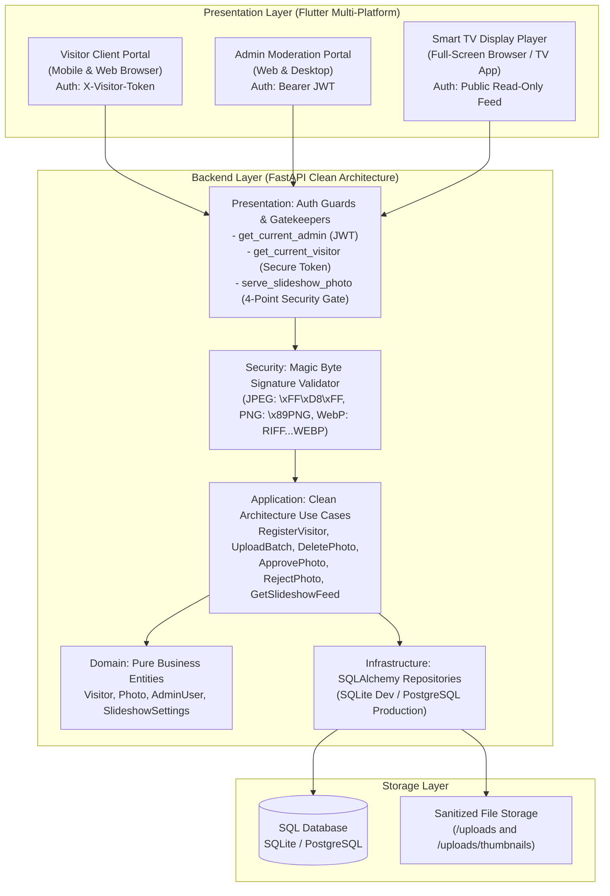
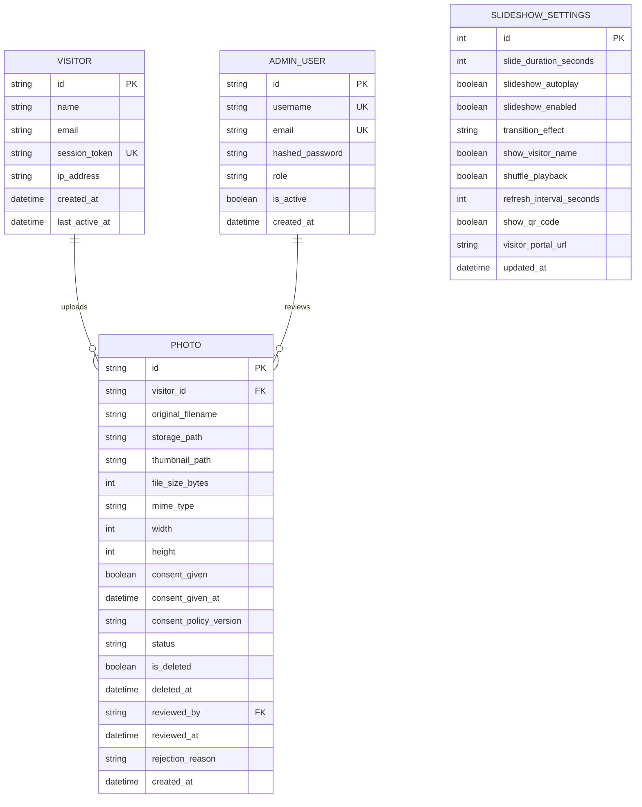

# Visitor Photo Slideshow — Architecture Blueprint

This document specifies the software architecture, Clean Architecture patterns, database design, security boundaries, and operational guarantees of the **Visitor Photo Slideshow Application**.

---

## 1. System Context & Overview

The system provides three integrated roles:
1. **Visitor Client (Mobile / Web)**: Guests scan a QR code on event screens to upload photos with explicit consent and review their photo approval status.
2. **Moderator Portal (Desktop / Web)**: Administrators authenticate via JWT to inspect incoming photos, verify consent records, approve or reject photos with reasons, and configure display parameters.
3. **Smart TV Display (Large Screens)**: Full-screen ambient slideshow player running continuously on TVs, PC monitors, and event projectors, auto-rotating approved photos and auto-refreshing in the background.

---

## 2. Security & Privacy Guarantees

### 2.1 Explicit Public-Display Consent
- The public-display consent checkbox on the visitor portal is **unchecked by default**.
- When checked, the backend records `consent_given = True`, `consent_given_at = UTC_TIMESTAMP`, and `consent_policy_version = "v1.0"`.
- If consent is missing or false, the backend rejects the upload with `HTTP 400 Bad Request`.
- The Admin use case strictly blocks approval of any photo without visitor consent.

### 2.2 Immediate Deletion Eviction
- Visitors have full sovereign control over their media and can delete their photos at any time.
- Deletion sets `is_deleted = True` and records `deleted_at`.
- Both the Smart TV display feed (`/api/v1/display/photos`) and the media streaming gatekeeper (`/api/v1/media/slideshow/{id}`) immediately evict and block deleted photos (returning HTTP 404).

### 2.3 Magic-Byte File Signature Verification
File extension and MIME header checking alone can be bypassed. The backend inspects the actual raw bytes of the file before accepting it:
- **JPEG**: Initial bytes must be `\xFF\xD8\xFF`.
- **PNG**: Initial 8 bytes must be `\x89PNG\r\n\x1a\n`.
- **WebP**: Bytes 0..4 must be `RIFF` and bytes 8..12 must be `WEBP`.
Disguised executables (e.g. `.exe` renamed to `.jpg`) are caught and rejected with HTTP 400 before decoding.

### 2.4 Cryptographic Visitor Tokens & Auth Isolation
- Visitor tokens are generated using Python's cryptographically secure `secrets.token_urlsafe(32)` (256 bits of entropy).
- Tokens are stored in platform keystores via `flutter_secure_storage`.
- Visitor tokens and Administrator JWT tokens use separate schemas and separate headers:
  - Visitors: `X-Visitor-Token: <token>`
  - Admins: `Authorization: Bearer <jwt>`
- Visitor tokens cannot authenticate against administrative endpoints.

---

## 3. Database Schema & Migration History

### Alembic Migration Chain
1. `c2b7e393be09`: Initial schema (`visitors`, `photos`, `admin_users`, `slideshow_settings`).
2. `c5c70b2e150c`: Added `email` to `visitors` table.
3. `c15e93b4660b`: Added `slideshow_autoplay` and `slideshow_enabled` to `slideshow_settings`.
4. `d48f71a9b201`: Added `show_qr_code` and `visitor_portal_url` to `slideshow_settings`.
