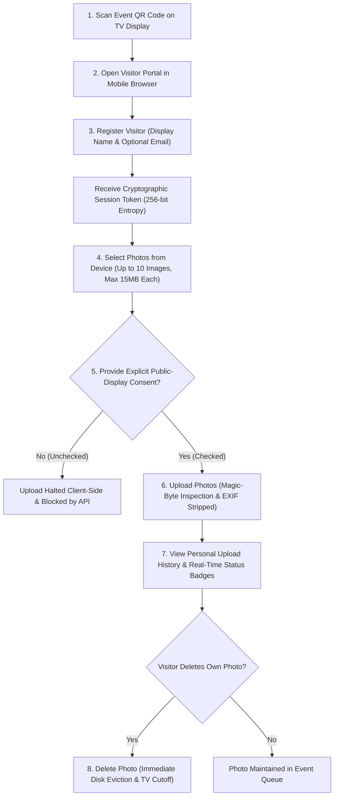
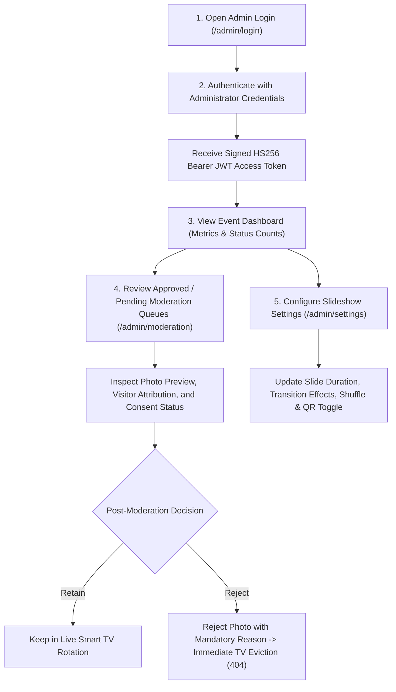
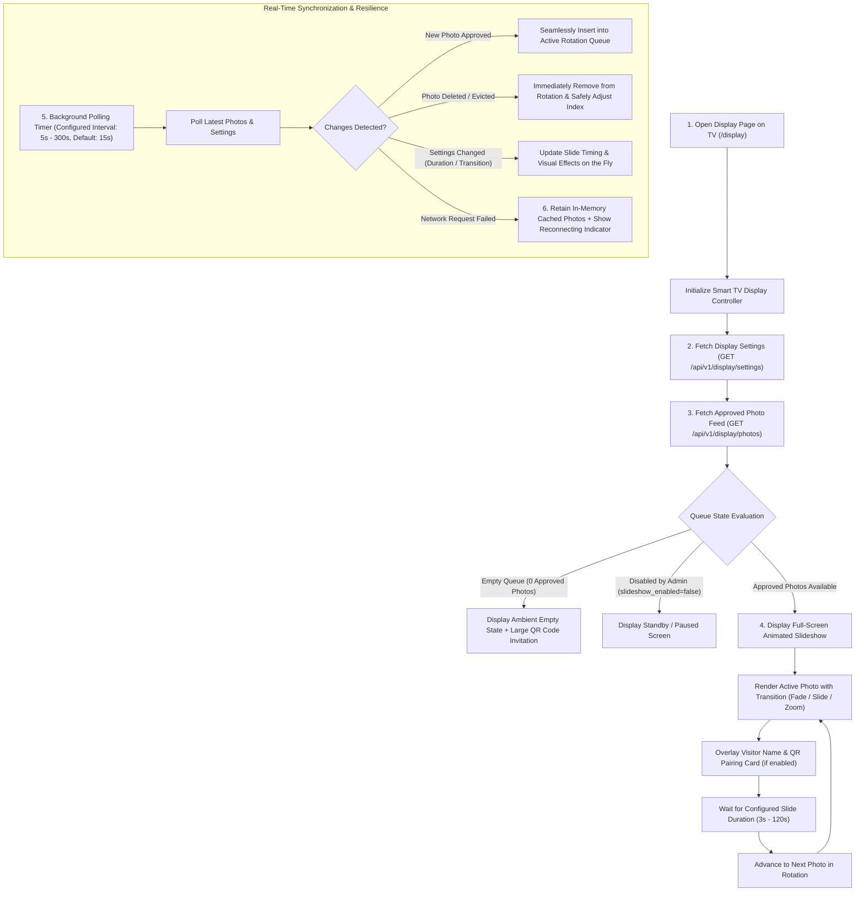
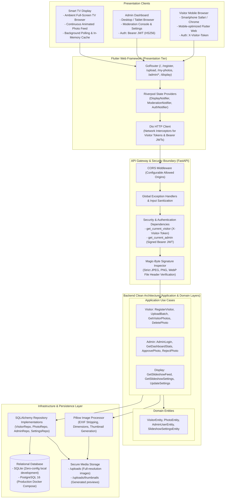

# Live Event Photo Slideshow Platform

[](https://flutter.dev)
[](https://dart.dev)
[](https://fastapi.tiangolo.com)
[](https://www.python.org)
[](https://www.sqlalchemy.org)
[](https://docs.pydantic.dev)
[](https://www.sqlite.org)
[](https://www.postgresql.org)
[](https://www.docker.com)
[](LICENSE)

An ambient display, photo moderation, and guest engagement platform engineered for live events, weddings, corporate conferences, and celebrations.

**GitHub Repository:** [vishw-byte/visitor-photo-slideshow](https://github.com/vishw-byte/visitor-photo-slideshow)<br>
**Release Branch:** `main`<br>
**License:** [MIT License](LICENSE)

---

## Table of Contents

- [1. Project Introduction](#1-project-introduction)
- [2. Problem Statement](#2-problem-statement)
- [3. Project Objectives](#3-project-objectives)
- [4. Key Features](#4-key-features)
- [5. System Workflows](#5-system-workflows)
  - [5.1 Visitor Workflow](#51-visitor-workflow)
  - [5.2 Admin & Moderation Workflow](#52-admin--moderation-workflow)
  - [5.3 Smart TV Slideshow Workflow](#53-smart-tv-slideshow-workflow)
- [6. Visual Walkthrough & Screenshots](#6-visual-walkthrough--screenshots)
- [7. System Architecture](#7-system-architecture)
  - [7.1 End-to-End Architecture Diagram](#71-end-to-end-architecture-diagram)
  - [7.2 Architectural Layers & Design Principles](#72-architectural-layers--design-principles)
- [8. Dynamic QR Code Pairing](#8-dynamic-qr-code-pairing)
- [9. Technology Stack](#9-technology-stack)
- [10. Database Schema & Data Models](#10-database-schema--data-models)
- [11. Backend REST API Specification](#11-backend-rest-api-specification)
- [12. Installation Prerequisites](#12-installation-prerequisites)
- [13. Local Development Setup](#13-local-development-setup)
  - [13.1 Backend Setup (FastAPI & SQLite)](#131-backend-setup-fastapi--sqlite)
  - [13.2 Frontend Setup (Flutter Web)](#132-frontend-setup-flutter-web)
  - [13.3 Local Wi-Fi & Smartphone Multi-Device Testing](#133-local-wi-fi--smartphone-multi-device-testing)
- [14. Environment Configuration](#14-environment-configuration)
  - [14.1 Configuration Variables Matrix](#141-configuration-variables-matrix)
  - [14.2 Local Development vs. Production Comparison](#142-local-development-vs-production-comparison)
- [15. Database Migrations (Alembic)](#15-database-migrations-alembic)
- [16. Backend Execution & Admin Management](#16-backend-execution--admin-management)
- [17. Flutter Frontend Execution Commands](#17-flutter-frontend-execution-commands)
- [18. Production Docker Deployment](#18-production-docker-deployment)
- [19. Automated Testing Instructions](#19-automated-testing-instructions)
- [20. Security, Privacy & Consent Guarantees](#20-security-privacy--consent-guarantees)
- [21. Known Limitations](#21-known-limitations)
- [22. Future Roadmap & Enhancements](#22-future-roadmap--enhancements)
- [23. Contributing](#23-contributing)
- [24. License](#24-license)

---

## 1. Project Introduction

The **Live Event Photo Slideshow Platform** bridges the gap between event attendees and large-screen ambient displays. Guests scan a venue display QR code using their standard smartphone mobile browser, grant explicit public-display consent, and submit photos directly from their device's camera roll without installing native apps or creating permanent accounts.

Upon passing server-side validation and explicit visitor consent, uploaded photos are automatically approved and queued into continuous, animated photo loops running on Smart TVs, projectors, and venue monitors. Event moderators maintain real-time post-moderation control via an authenticated administration console, with the ability to instantly reject and evict any inappropriate submission. Deleting a photo from a visitor's mobile history instantly purges the file from storage and cuts off display streaming in real time.

---

## 2. Problem Statement

At live social gatherings, weddings, and corporate summits:
- **Dispersed Media**: Collecting attendee photos typically relies on post-event shared cloud drives or social media hashtags that suffer from delayed participation, compressed media, and zero live presentation value.
- **Brand & Content Risk**: Unmoderated open screens risk broadcasting accidental camera roll uploads, copyrighted graphics, or inappropriate photos publicly.
- **Friction-Heavy Guest Onboarding**: Commercial event solutions frequently mandate downloading third-party mobile applications, completing complex social OAuth registrations, or granting intrusive device permissions.
- **Hardware Flakiness**: Traditional web presentation tools stutter on large displays, fail completely when venue Wi-Fi fluctuates, or lack hardware-accelerated animations suited for TV form factors.

---

## 3. Project Objectives

- **Zero-Friction Guest Upload**: Pure web client requiring zero app store downloads. Guests scan an on-screen QR code and upload within seconds.
- **Privacy & Explicit Visitor Consent**: Mandatory, un-checked-by-default opt-in for public screen projection, backed by tamper-evident database audit timestamps and instant self-service deletion.
- **Automatic Approval with Real-Time Host Moderation**: Validated and consented photos go live immediately on event screens, while event hosts maintain an audited post-moderation console to review live media, inspect visitor attribution, and immediately reject or evict any photo.
- **Ambient Smart TV Experience**: Full-screen, continuous animated slideshow playback with hardware-accelerated cross-fades, slide transitions, zoom effects, and offline resilience during momentary network drops.
- **Production-Hardened Engineering**: Enforced magic-byte file signature validation, 256-bit cryptographic session tokens, signed HMAC-SHA256 admin tokens, and turnkey multi-stage Docker Compose deployments.

---

## 4. Key Features

- **Guest Portal (`/` & `/upload`)**: Mobile-responsive web client supporting multi-photo batch selection (up to 10 photos, 15 MB each), live thumbnail previews, upload progress indicators, personal submission history, and instant self-deletion.
- **Explicit Consent Gatekeeper**: Mandatory public-display agreement checkbox. If unchecked, photo uploads are halted client-side and blocked at the API layer with HTTP 400.
- **Moderator Console (`/admin/dashboard` & `/admin/moderation`)**: Password-authenticated administrative portal featuring real-time photo metrics, tabbed status queues (`Pending`, `Approved`, `Rejected`), and audited rejection logging.
- **Smart TV Ambient Player (`/display`)**: Continuous landscape player featuring customizable slide durations (3–120 seconds), configurable transition effects (`Fade`, `Slide`, `Zoom`), playback shuffle, visitor name attribution overlay, remote keyboard navigation (`F` for Fullscreen, `ArrowRight`/`Space` for Next, `ArrowLeft` for Previous), and standby screens.
- **Dynamic QR Pairing (`/api/v1/display/qr-code`)**: On-screen QR code overlay generated server-side, directing smartphones strictly to the venue's verified visitor portal URL.
- **Resilient Playback Architecture**: In-memory rotation state caches approved photos locally on the display client, maintaining continuous animations even during momentary Wi-Fi fluctuations.

---

## 5. System Workflows

### 5.1 Visitor Workflow

The visitor workflow provides a friction-free, secure pathway for guests to submit media and retain ownership over their uploads.



### 5.2 Admin & Moderation Workflow

Event organizers authenticate to manage moderation queues, inspect submissions, and control live screen playback parameters.



### 5.3 Smart TV Slideshow Workflow

The TV slideshow operates autonomously as an ambient cinema display, dynamically synchronizing with backend moderation updates through resilient polling.



---

## 6. Visual Walkthrough & Screenshots

> [!NOTE]
> The screenshots below illustrate the interface states defined in the repository visual specifications. For image dimensions, dark-mode palettes, and capture instructions, refer to [docs/SCREENSHOTS.md](file:///C:/photo%20slider/docs/SCREENSHOTS.md).

### 6.1 Interface Gallery

| Viewport | Screen / Functionality | Route | Asset Location |
| :--- | :--- | :--- | :--- |
| **Mobile (390×844)** | **Visitor Welcome & Portal** | `/` | `docs/screenshots/01_welcome_screen.png` |
| **Mobile (390×844)** | **Visitor Registration** | `/register` | `docs/screenshots/02_visitor_registration.png` |
| **Mobile (390×844)** | **Photo Upload & Explicit Consent** | `/upload` | `docs/screenshots/03_photo_upload_consent.png` |
| **Mobile (390×844)** | **My Uploads & Status History** | `/my-photos` | `docs/screenshots/04_my_photos_history.png` |
| **Desktop (1920×1080)** | **Admin Authentication** | `/admin/login` | `docs/screenshots/05_admin_login.png` |
| **Desktop (1920×1080)** | **Admin Metric Dashboard** | `/admin/dashboard` | `docs/screenshots/06_admin_dashboard.png` |
| **Desktop (1920×1080)** | **Photo Moderation Queue** | `/admin/moderation` | `docs/screenshots/07_photo_moderation.png` |
| **Desktop (1920×1080)** | **Slideshow Display Settings** | `/admin/settings` | `docs/screenshots/08_slideshow_settings.png` |
| **TV Display (1920×1080)** | **Active Smart TV Slideshow** | `/display` | `docs/screenshots/09_smart_tv_active.png` |
| **TV Display (1920×1080)** | **TV Empty Queue & QR Pairing** | `/display` | `docs/screenshots/10_smart_tv_empty_qr.png` |

### 6.2 Visual Placeholders

```
+------------------------------------------------------------------------------------+
|                         [SCREENSHOT PLACEHOLDER]                                   |
|                                                                                    |
|  1. VISITOR PORTAL & CONSENT (Mobile Viewport: 390x844)                            |
|     - File: docs/screenshots/03_photo_upload_consent.png                           |
|     - Displays batch thumbnail previews, removal chips, and mandatory explicit     |
|       public-display consent checkbox.                                             |
|                                                                                    |
|  2. MODERATOR CONSOLE (Desktop Viewport: 1920x1080)                                |
|     - File: docs/screenshots/07_photo_moderation.png                               |
|     - Displays pending moderation cards, visitor attribution, consent verified     |
|       badge, and one-click Approve / Reject action buttons.                        |
|                                                                                    |
|  3. SMART TV AMBIENT CINEMA DISPLAY (TV Viewport: 1920x1080)                       |
|     - File: docs/screenshots/09_smart_tv_active.png                                |
|     - Full-screen photo presentation, animated transitions, subtle visitor         |
|       attribution overlay, and dynamic corner QR pairing card.                     |
+------------------------------------------------------------------------------------+
```

---

## 7. System Architecture

The platform is designed following **Clean Architecture** and **SOLID** principles, maintaining strict separation between presentation clients, API orchestration, domain entities, and infrastructure storage.

### 7.1 End-to-End Architecture Diagram



### 7.2 Architectural Layers & Design Principles

1. **Domain Layer**: Pure business logic containing entity definitions (`VisitorEntity`, `PhotoEntity`, `AdminUserEntity`, `SlideshowSettingsEntity`) and abstract repository interfaces. It has zero dependencies on external frameworks or databases.
2. **Application Layer**: Contains use-case orchestrators (`UploadBatchPhotosUseCase`, `ApprovePhotoUseCase`, `GetSlideshowFeedUseCase`) and Pydantic request/response DTOs.
3. **Infrastructure Layer**: Concrete implementations of repositories using SQLAlchemy 2.0, local filesystem storage management, Pillow image processing, and cryptographic security utilities.
4. **Presentation Layer**:
   - **Backend**: FastAPI REST routers (`/visitors`, `/photos`, `/admin`, `/display`, `/media`, `/health`) with dependency injection for authentication and database sessions.
   - **Frontend**: Flutter Web application driven by Riverpod state providers, GoRouter navigation, and a Dio HTTP client configured with automated token injection.

---

## 8. Dynamic QR Code Pairing

- **Server Endpoint**: `GET /api/v1/display/qr-code` dynamically renders a high-contrast PNG image encoding the visitor portal URL.
- **Strict Public URL Resolution**:
  - In **Production**: Strictly requires a valid public HTTPS URL (e.g. `https://photos.yourdomain.com`). If a `localhost`, `127.0.0.1`, or `0.0.0.0` address is configured in production, the server halts with HTTP 500 to prevent exposing unreachable URLs on public screens.
  - In **Local Development**: Encodes the configured local network address (e.g. `http://<YOUR_LAN_IP>:3000/`) allowing physical smartphones on the same Wi-Fi network to connect seamlessly.
- **Display Modes**:
  - **Ambient Overlay**: Displayed as a compact card in the bottom-right corner during active photo rotations.
  - **Hero Invitation**: Displayed prominently in the center of the screen when the approved photo queue is empty.
  - **Host Toggle**: Organizers can show or hide the QR code at any time via Admin Settings without interrupting active rotations.

---

## 9. Technology Stack

### Frontend (Cross-Platform Web Client)
- **Framework**: [Flutter](https://flutter.dev) (v3.41+)
- **Language**: [Dart](https://dart.dev) (v3.11+)
- **State Management**: [Flutter Riverpod](https://pub.dev/packages/flutter_riverpod) (v2.6)
- **Routing**: [GoRouter](https://pub.dev/packages/go_router) (v14.8)
- **HTTP Networking**: [Dio](https://pub.dev/packages/dio) (v5.8) with custom Auth & Token interceptors
- **QR Rendering**: [qr_flutter](https://pub.dev/packages/qr_flutter) (v4.1)

### Backend (REST API Gateway)
- **Framework**: [FastAPI](https://fastapi.tiangolo.com) (v0.115+)
- **Runtime**: [Python](https://www.python.org) (v3.11+)
- **ORM & Data Mapping**: [SQLAlchemy](https://www.sqlalchemy.org) (v2.0)
- **Schema Validation**: [Pydantic](https://docs.pydantic.dev) (v2.10) & Pydantic-Settings
- **Database Migrations**: [Alembic](https://alembic.sqlalchemy.org) (v1.14)
- **Image Processing**: [Pillow](https://python-pillow.org) (v11.1) for EXIF removal and thumbnailing
- **Authentication**: [PyJWT](https://pyjwt.readthedocs.io) (v2.10) for signed HMAC-SHA256 tokens & [bcrypt](https://pypi.org/project/bcrypt/) password hashing
- **QR Code Generation**: [qrcode](https://pypi.org/project/qrcode/) (v8.0)

### Infrastructure & Deployment
- **Local Database**: [SQLite](https://www.sqlite.org) (Zero-config out of the box)
- **Production Database**: [PostgreSQL](https://www.postgresql.org) 16 Alpine
- **Web Server / Reverse Proxy**: [Nginx](https://nginx.org) Alpine (multi-stage SPA serving)
- **Containerization**: [Docker](https://www.docker.com) Engine 24+ & [Docker Compose](https://docs.docker.com/compose/) v2.20+

---

## 10. Database Schema & Data Models

The relational schema supports both SQLite (local development) and PostgreSQL (production) without schema drift:

```
+--------------------------------------------------------------------------------------------------+
|                                      DATABASE SCHEMA OVERVIEW                                    |
+--------------------------------------------------------------------------------------------------+
| visitors                                                                                         |
|   id: String(36) [PK, UUID]                                                                      |
|   name: String(100) [NOT NULL]                                                                   |
|   email: String(255) [NULLABLE, Indexed]                                                         |
|   session_token: String(64) [UNIQUE, NOT NULL, Indexed, 256-bit entropy]                         |
|   ip_address: String(45) [NULLABLE]                                                              |
|   created_at: DateTime [NOT NULL, UTC]                                                           |
+--------------------------------------------------------------------------------------------------+
| photos                                                                                           |
|   id: String(36) [PK, UUID]                                                                      |
|   visitor_id: String(36) [FK -> visitors.id, Indexed]                                            |
|   original_filename: String(255) [NOT NULL]                                                      |
|   storage_path: String(500) [NOT NULL]                                                           |
|   thumbnail_path: String(500) [NOT NULL]                                                         |
|   file_size_bytes: Integer [NOT NULL]                                                            |
|   mime_type: String(50) [NOT NULL]                                                               |
|   width: Integer [NOT NULL]                                                                      |
|   height: Integer [NOT NULL]                                                                     |
|   status: Enum('PENDING', 'APPROVED', 'REJECTED') [NOT NULL, Default 'PENDING', Indexed]          |
|   consent_given: Boolean [NOT NULL, Default False]                                               |
|   consent_given_at: DateTime [NULLABLE, UTC]                                                     |
|   consent_policy_version: String(20) [NOT NULL, Default 'v1.0']                                  |
|   reviewed_by: String(36) [FK -> admin_users.id, NULLABLE]                                       |
|   reviewed_at: DateTime [NULLABLE, UTC]                                                          |
|   rejection_reason: Text [NULLABLE]                                                              |
|   is_deleted: Boolean [NOT NULL, Default False, Indexed]                                         |
|   deleted_at: DateTime [NULLABLE, UTC]                                                           |
|   created_at: DateTime [NOT NULL, UTC]                                                           |
+--------------------------------------------------------------------------------------------------+
| admin_users                                                                                      |
|   id: String(36) [PK, UUID]                                                                      |
|   username: String(50) [UNIQUE, NOT NULL, Indexed]                                               |
|   email: String(255) [UNIQUE, NULLABLE]                                                          |
|   hashed_password: String(255) [NOT NULL, bcrypt]                                                |
|   role: String(20) [NOT NULL, Default 'ADMIN']                                                   |
|   is_active: Boolean [NOT NULL, Default True]                                                    |
|   created_at: DateTime [NOT NULL, UTC]                                                           |
+--------------------------------------------------------------------------------------------------+
| slideshow_settings (Singleton Record: ID = 1)                                                    |
|   id: Integer [PK, Default 1]                                                                    |
|   slide_duration_seconds: Integer [NOT NULL, Default 10]                                         |
|   slideshow_autoplay: Boolean [NOT NULL, Default True]                                           |
|   slideshow_enabled: Boolean [NOT NULL, Default True]                                            |
|   transition_effect: String(20) [NOT NULL, Default 'FADE']                                       |
|   show_visitor_name: Boolean [NOT NULL, Default True]                                            |
|   shuffle_playback: Boolean [NOT NULL, Default False]                                            |
|   refresh_interval_seconds: Integer [NOT NULL, Default 15]                                       |
|   show_qr_code: Boolean [NOT NULL, Default True]                                                 |
|   visitor_portal_url: String(500) [NULLABLE]                                                     |
|   updated_at: DateTime [NOT NULL, UTC]                                                           |
+--------------------------------------------------------------------------------------------------+
```

---

## 11. Backend REST API Specification

All endpoints are prefixed with `/api/v1` (with the exception of the API root service metadata).

| Method | Route | Description | Authentication Scheme | Scope / Rules |
| :--- | :--- | :--- | :--- | :--- |
| `GET` | `/` | API service root & version info | None | Public status probe |
| `GET` | `/api/v1/health` | Application & DB health probe | None | Returns 200 OK or 503 Service Unavailable |
| `POST` | `/api/v1/visitors/register` | Register guest & issue session token | None | Generates 256-bit cryptographically secure token |
| `POST` | `/api/v1/photos/upload` | Batch upload photos (1–10 files) | `X-Visitor-Token` | Requires `consent_given=true`; enforces magic bytes |
| `GET` | `/api/v1/photos/my-photos` | Retrieve personal photo history | `X-Visitor-Token` | Strictly scoped to requesting visitor |
| `DELETE` | `/api/v1/photos/{id}` | Delete photo & evict from TV display | `X-Visitor-Token` | Immediate disk purge & soft-delete flag |
| `POST` | `/api/v1/admin/login` | Authenticate moderator & return JWT | None | Rate-limited; verifies bcrypt password |
| `GET` | `/api/v1/admin/dashboard` | Event aggregate metrics | `Bearer <JWT>` | Total, Pending, Approved, Rejected, Visitors |
| `GET` | `/api/v1/admin/photos/pending` | Moderation queue for pending photos | `Bearer <JWT>` | Pagination via `skip` and `limit` |
| `GET` | `/api/v1/admin/photos/approved` | Queue of approved slideshow photos | `Bearer <JWT>` | Shows active rotation items |
| `GET` | `/api/v1/admin/photos/rejected` | Archive of rejected photos with notes | `Bearer <JWT>` | Displays audited rejection reason |
| `PATCH` | `/api/v1/admin/photos/{id}/approve` | Approve photo for TV playback | `Bearer <JWT>` | Validates explicit consent before approving |
| `PATCH` | `/api/v1/admin/photos/{id}/reject` | Reject photo with mandatory reason | `Bearer <JWT>` | Rejection reason recorded in audit log |
| `GET` | `/api/v1/admin/settings` | Retrieve active slideshow configuration | `Bearer <JWT>` | Returns full settings singleton |
| `PUT` | `/api/v1/admin/settings` | Update timings, transitions & toggles | `Bearer <JWT>` | Applies updates dynamically to TV feed |
| `GET` | `/api/v1/display/photos` | Continuous Smart TV photo feed | None (Public) | Only approved, consented, non-deleted photos |
| `GET` | `/api/v1/display/settings` | Public display parameters | None (Public) | Returns verified `portal_url` and duration |
| `GET` | `/api/v1/display/qr-code` | Dynamic PNG QR code image | None (Public) | Resolves verified portal URL; forbids prod localhost |
| `GET` | `/api/v1/media/slideshow/{id}` | Streaming gatekeeper for Smart TV | None (Gated) | Returns 404 if unapproved, revoked, or deleted |
| `GET` | `/api/v1/media/photos/{id}` | Protected full-resolution image | `Bearer <JWT>` or `X-Visitor-Token` | Accessible only by Admin or owning Visitor |
| `GET` | `/api/v1/media/thumbnails/{id}` | Protected thumbnail image | `Bearer <JWT>` or `X-Visitor-Token` | Accessible by Admin, owner, or if approved |

---

## 12. Installation Prerequisites

Ensure the following tools are installed on your host machine before local execution:

- **Python**: 3.11 or higher
- **Flutter SDK**: 3.27+ (Recommended: 3.41+)
- **Git**: 2.30+
- **Docker Engine & Docker Compose**: 24.0+ & 2.20+ (Required only for container deployment)
- **Web Browser**: Google Chrome or any modern Chromium / Safari browser

---

## 13. Local Development Setup

### 13.1 Backend Setup (FastAPI & SQLite)

Open a terminal and navigate to the `backend` directory:

#### Windows PowerShell:
```powershell
cd "C:\photo slider\backend"

# 1. Create and activate virtual environment
python -m venv venv
.\venv\Scripts\Activate.ps1

# 2. Install dependencies
pip install -r requirements.txt

# 3. Initialize local environment configuration
Copy-Item .env.example .env

# 4. Run database migrations (creates local SQLite slideshow.db)
alembic upgrade head

# 5. Start development API server
python main.py
```

#### Linux / macOS:
```bash
cd backend

# 1. Create and activate virtual environment
python3 -m venv venv
source venv/bin/activate

# 2. Install dependencies
pip install -r requirements.txt

# 3. Initialize local environment configuration
cp .env.example .env

# 4. Run database migrations
alembic upgrade head

# 5. Start development API server
python main.py
```

The API service runs locally at `http://127.0.0.1:8000`.<br>
Interactive Swagger documentation is available at `http://127.0.0.1:8000/docs`.

### 13.2 Frontend Setup (Flutter Web)

Open a second terminal and navigate to the `frontend` directory:

```bash
cd "C:\photo slider\frontend"

# Fetch Flutter dependencies
flutter pub get

# Run the Flutter Web development client on port 3000
flutter run -d chrome --web-port 3000
```

The web client opens automatically at `http://localhost:3000`.

---

### 13.3 Local Wi-Fi & Smartphone Multi-Device Testing

To test the complete workflow (scanning the Smart TV QR code and uploading photos directly from a smartphone connected to the same local Wi-Fi):

1. **Find your computer's Wi-Fi IPv4 address**:
   - **Windows PowerShell**:
     ```powershell
     ipconfig
     # Locate "IPv4 Address" under your Wireless LAN adapter (e.g. <YOUR_LAN_IP>)
     ```
   - **Linux / macOS**:
     ```bash
     ip a || ifconfig
     ```

2. **Configure `backend/.env`**:
   Set `HOST` to `0.0.0.0` and point `PUBLIC_PORTAL_URL` to your laptop's LAN IP:
   ```env
   HOST="0.0.0.0"
   PORT=8000
   PUBLIC_PORTAL_URL="http://<YOUR_LAN_IP>:3000/"
   ```
   *(Replace `<YOUR_LAN_IP>` with your computer's actual Wi-Fi IPv4 address on the local network)*.

3. **Start the backend server on all network interfaces (`0.0.0.0:8000`)**:
   ```powershell
   cd backend
   python -m uvicorn main:app --host 0.0.0.0 --port 8000
   ```

4. **Build and serve the Flutter Web SPA**:
   Compile the release bundle and start the local multi-device web server:
   ```powershell
   # In frontend directory:
   cd frontend
   flutter build web --release

   # In project root directory:
   cd ..
   python serve_web.py
   ```
   *The server listens on `0.0.0.0:3000`, making the Flutter SPA accessible across your local network.*

5. **Open the Smart TV Display**:
   - Open a browser on your laptop or TV at: `http://<YOUR_LAN_IP>:3000/#/display`.
   - The display automatically loads and renders a dynamic QR code encoding `http://<YOUR_LAN_IP>:3000/`.

6. **Test with your Smartphone**:
   - Connect your phone to the same Wi-Fi network.
   - Scan the on-screen TV QR code with your phone camera.
   - The browser opens the Visitor Portal at `http://<YOUR_LAN_IP>:3000/#/welcome`.
   - Register, select photos, check the explicit consent checkbox, and submit.
   - The approved photos appear immediately on the TV slideshow display on the next polling cycle.
   - You can also log into the Moderator Portal at `http://<YOUR_LAN_IP>:3000/#/admin/login` to review live photos, perform post-moderation rejection, or adjust slideshow duration.

---

## 14. Environment Configuration

### 14.1 Configuration Variables Matrix

| Variable Name | Default Value (Dev) | Description | Production Requirement |
| :--- | :--- | :--- | :--- |
| `PROJECT_NAME` | `Visitor Photo Slideshow API` | Application title reported in logs & health probes | Optional customization |
| `VERSION` | `1.0.0` | API release version | Semantic version string |
| `ENVIRONMENT` | `development` | Runtime environment mode | Must be set to `production` |
| `DEBUG` | `true` | Enables verbose stack traces | Must be set to `false` |
| `SECRET_KEY` | `local-dev-secret-key-32-chars...` | 256-bit cryptographic key for signing JWTs | **Mandatory**: Minimum 32 chars, random hex |
| `ALGORITHM` | `HS256` | JWT cryptographic signature algorithm | `HS256` |
| `ACCESS_TOKEN_EXPIRE_MINUTES` | `1440` (24 Hours) | Admin session lifetime | Integer minutes |
| `ADMIN_DEFAULT_USERNAME` | `admin` | Initial seeded administrator username | Standard username |
| `ADMIN_DEFAULT_PASSWORD` | `ChangeMeInProduction123!` | Initial seeded administrator password | **Mandatory**: Must be changed from default |
| `DATABASE_URL` | `sqlite:///./slideshow.db` | SQLAlchemy database connection string | `postgresql+psycopg2://...` in production |
| `HOST` | `0.0.0.0` | ASGI network binding interface | `0.0.0.0` (Container internal) |
| `PORT` | `8000` | ASGI network listening port | Integer port |
| `PUBLIC_PORTAL_URL` | `http://127.0.0.1:3000` | Base URL encoded into Smart TV QR code | **Mandatory**: Valid public HTTPS URL (No localhost) |
| `UPLOAD_DIR` | `./uploads` | Filesystem path for full-resolution photos | Persistent container volume |
| `THUMBNAIL_DIR` | `./uploads/thumbnails` | Filesystem path for generated thumbnails | Persistent container volume |
| `MAX_FILE_SIZE_MB` | `15` | Maximum upload size per photo | Integer megabytes |
| `MAX_UPLOAD_BATCH_SIZE` | `10` | Maximum photos per batch submission | Integer count |
| `CORS_ORIGINS` | `*` | Allowed cross-origin domains | **Mandatory**: Exact HTTPS origins (No wildcard `*`) |

### 14.2 Local Development vs. Production Comparison

```
+---------------------------+-----------------------------------+-----------------------------------------+
| Feature / Setting         | Local Development                 | Production Environment                  |
+---------------------------+-----------------------------------+-----------------------------------------+
| ENVIRONMENT               | development                       | production                              |
| Database Engine           | SQLite (slideshow.db)             | PostgreSQL 16 Alpine                    |
| SECRET_KEY                | Development default accepted      | Minimum 32 chars, cryptographically random |
| ADMIN_DEFAULT_PASSWORD    | Development default accepted      | Default strictly rejected at startup    |
| PUBLIC_PORTAL_URL         | http://<YOUR_LAN_IP>:3000/        | Must begin with https:// (No localhost) |
| CORS_ORIGINS              | * (Wildcard permitted)            | Specific origins only (No wildcard)     |
| TLS / SSL                 | Plain HTTP                        | Enforced HTTPS / TLS termination        |
| Process Manager           | Uvicorn with auto-reload          | Multi-worker Uvicorn / Nginx container  |
+---------------------------+-----------------------------------+-----------------------------------------+
```

---

## 15. Database Migrations (Alembic)

Database schema revisions are managed using Alembic:

```bash
cd backend

# Apply all pending migrations to the database:
alembic upgrade head

# Generate a new autogenerated migration script after modifying models:
alembic revision --autogenerate -m "add_new_entity_field"

# Rollback the last applied migration:
alembic downgrade -1
```

---

## 16. Backend Execution & Admin Management

### 16.1 Development Server Execution
```powershell
cd backend
python main.py
```

### 16.2 Production Multi-Worker Execution
```bash
cd backend
uvicorn main:app --host 0.0.0.0 --port 8000 --workers 4
```

### 16.3 Secure Administrator Account Creation & Password Update

To bootstrap a new administrator or securely update an existing administrator's credentials without exposing passwords in command histories:

#### Windows PowerShell:
```powershell
cd backend
python scripts/create_admin.py --username admin --email admin@event.local
```

#### Linux / macOS:
```bash
cd backend
python scripts/create_admin.py --username admin --email admin@event.local
```

> [!IMPORTANT]
> When executing `create_admin.py`, omit the password argument. The script will securely prompt you with **masked input** (`getpass`) and a confirmation check. Passwords are never logged in shell histories or stored in plaintext.

---

## 17. Flutter Frontend Execution Commands

All commands are executed from the `frontend` directory:

```bash
cd frontend

# Install package dependencies
flutter pub get

# Run interactive web development client
flutter run -d chrome --web-port 3000

# Execute static code analysis
flutter analyze

# Execute frontend test suite
flutter test

# Compile production-ready web release bundle
flutter build web --release
```

---

## 18. Production Docker Deployment

A turnkey, multi-container architecture is orchestrated using Docker Compose (PostgreSQL 16 + FastAPI + Nginx Flutter Web):

### 18.1 Prepare Production Configuration
```bash
# In project root:
cp .env.example .env
```

Generate a secure 256-bit random secret key:
```bash
python -c "import secrets; print(secrets.token_hex(32))"
```

Edit `.env` and set:
- `SECRET_KEY`: Insert the generated 64-character hex key.
- `POSTGRES_PASSWORD`: Strong password for the PostgreSQL container.
- `ADMIN_DEFAULT_PASSWORD`: Strong initial bootstrap password.
- `PUBLIC_PORTAL_URL`: Your verified public domain (e.g. `https://photos.yourdomain.com`).
- `CORS_ORIGINS`: Your verified public domain (e.g. `https://photos.yourdomain.com`).

### 18.2 Launch Services
```bash
docker compose up -d --build
```

### 18.3 Verify Container Health
```bash
docker compose ps
curl http://localhost:8000/api/v1/health
```

Expected health response:
```json
{
  "status": "healthy",
  "app_name": "Visitor Photo Slideshow API",
  "version": "1.0.0",
  "environment": "production",
  "database": {
    "status": "connected",
    "dialect": "postgresql",
    "latency_ms": 1.45
  }
}
```

---

## 19. Automated Testing Instructions

Both frontend and backend include automated test suites covering authentication, upload limits, consent enforcement, magic-byte inspection, and UI state flows.

### 19.1 Run Backend Test Suite (49 Tests)

```powershell
# Windows PowerShell:
cd backend
.\venv\Scripts\Activate.ps1
pytest -v
```

```bash
# Linux / macOS:
cd backend
source venv/bin/activate
pytest -v
```

*All 49 unit, integration, and security test cases execute against an in-memory SQLite test database.*

### 19.2 Run Frontend Test Suite (25 Tests)

```bash
cd frontend
flutter test
```

*Executes 25 widget, provider, and navigation tests verifying form validation, Riverpod display state transitions, and responsive rendering.*

---

## 20. Security, Privacy & Consent Guarantees

- **Magic-Byte Signature Inspection**: Uploaded files undergo binary header inspection. Files with mismatched extensions or disguised executables are rejected immediately (`\xFF\xD8\xFF` for JPEG, `\x89PNG` for PNG, `RIFF...WEBP` for WebP).
- **Session Isolation & Cryptographic Entropy**: Guest sessions are backed by 256-bit cryptographic tokens generated via Python's `secrets.token_urlsafe(32)`. Visitors can only access, view, and delete their own uploads.
- **Admin JWT Authentication**: Admin tokens are cryptographically signed using HMAC-SHA256 (`HS256`) with strict expiration enforcement (24-hour default). Passwords are salted and hashed using bcrypt (cost factor 12).
- **Explicit Visitor Consent Audit**: Every photo upload requires explicit, un-checked-by-default visitor consent. Consent timestamps and policy versions are recorded immutably in the database.
- **Immediate Display Eviction**: When a visitor deletes a photo from their mobile device, the database record is marked as deleted, physical files are purged from disk storage, and any subsequent display media request immediately returns `HTTP 404 Not Found`.
- **Missing File Resilience**: The Smart TV feed verifies file presence on disk before serving. If a file is missing or corrupted, it is omitted from the feed without interrupting the live slideshow.

---

## 21. Known Limitations

- **Server-Side Resizing**: Thumbnail generation and dimension inspection currently execute on the server via Pillow. High-megapixel photos upload raw payloads before thumbnail processing.
- **In-Memory TV Cache Scope**: The TV web client maintains approved photos in memory during the active session. If an operator performs a hard page refresh (`Ctrl+F5`), the client requires active network connectivity to fetch the initial manifest.
- **Polling Synchronization**: The TV display relies on background HTTP polling (default: 15-second intervals) rather than full-duplex WebSockets.

---

## 22. Future Roadmap & Enhancements

- [ ] **Client-Side Image Compression**: Integrate browser canvas downscaling before network transfer to reduce upload times on congested venue cellular networks.
- [ ] **Progressive Web App (PWA) Offline Storage**: Add IndexedDB and ServiceWorker caching for Smart TV displays to support uninterrupted playback across full system restarts during internet outages.
- [ ] **WebSocket / Server-Sent Events (SSE)**: Implement real-time push notification channels to eliminate polling latency and present newly approved photos instantly.
- [ ] **Interactive Audience Reactions**: Enable guests to send floating animated emoji reactions (hearts, applause, celebration) over the live display.

---

## 23. Contributing

Contributions, bug reports, and feature proposals are welcome!

1. Fork the repository on GitHub: [vishw-byte/visitor-photo-slideshow](https://github.com/vishw-byte/visitor-photo-slideshow)
2. Create a feature branch: `git checkout -b feature/amazing-feature`
3. Run tests and static analyzers:
   ```bash
   cd backend && pytest
   cd ../frontend && flutter analyze && flutter test
   ```
4. Commit your changes: `git commit -m "feat: add amazing feature"`
5. Push to your branch: `git push origin feature/amazing-feature`
6. Open a Pull Request.

---

## 24. License

This project is licensed under the terms of the **MIT License**. See the [LICENSE](LICENSE) file for complete details.
