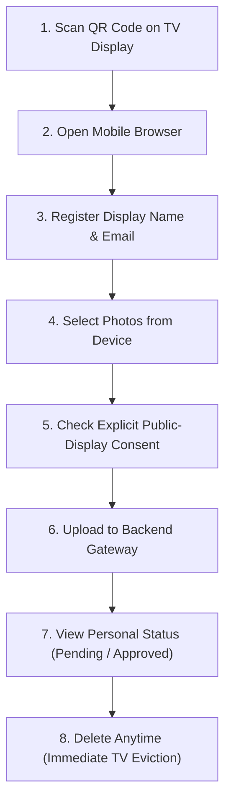
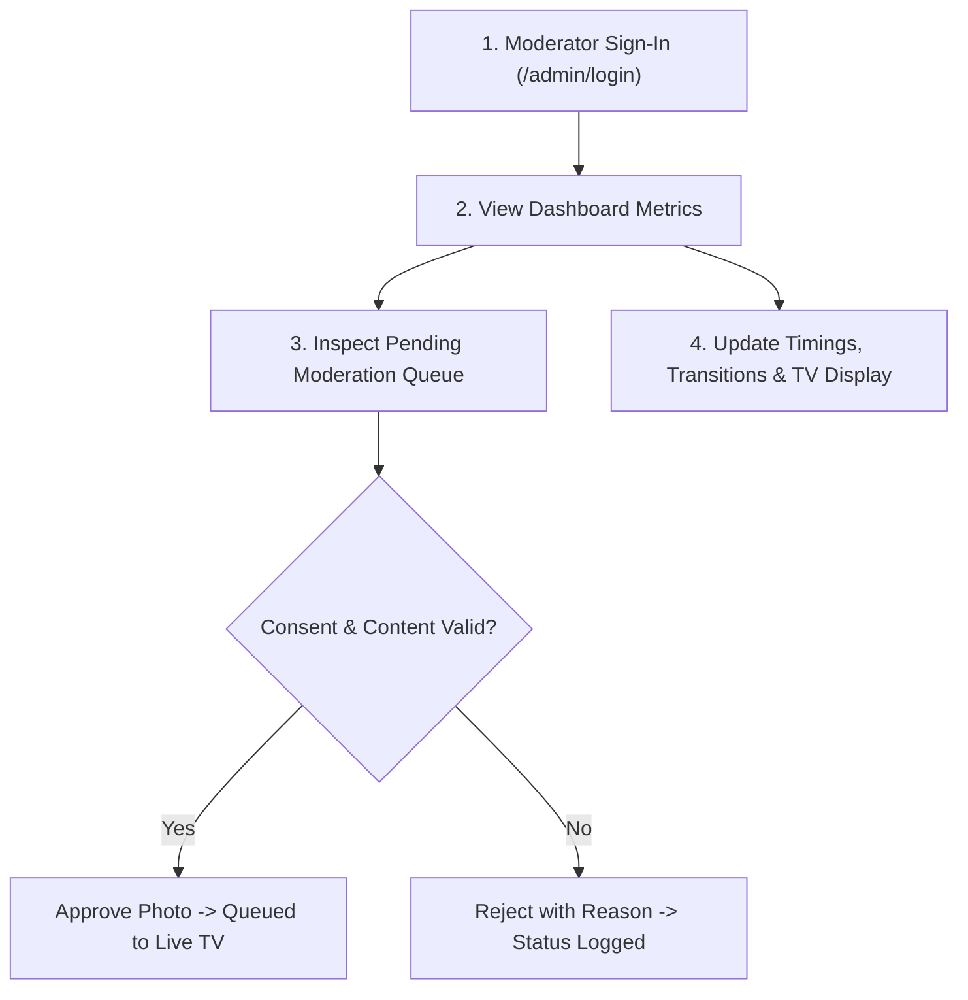
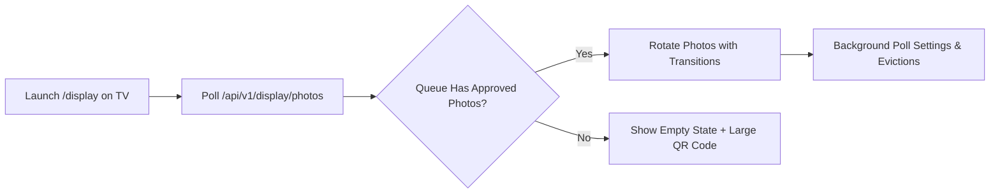

# Live Event Photo Slideshow Platform

An ambient display and photo moderation system designed for live events, weddings, corporate conferences, and celebrations.

---

## 1. Project Introduction

The **Live Event Photo Slideshow Platform** bridges the gap between event attendees and large-screen event displays. Guests scan a venue display QR code using their mobile browsers, grant explicit public-display consent, and submit photos directly from their smartphone camera roll. Event moderators review and approve submissions in real-time, and approved photos immediately rotate on ambient Smart TVs, projectors, and venue monitors.

---

## 2. Problem Statement

At live social and corporate events:
- Gathering guest photos typically requires post-event shared drives or social media hashtags that lack privacy control and real-time presentation.
- Unmoderated live screens risk displaying inappropriate, accidental, or low-quality photos publicly.
- Complex third-party event platforms require guests to download mobile apps, create accounts, or share invasive personal permissions.
- Existing displays frequently break when Wi-Fi fluctuates or lack smooth hardware-accelerated animations on large TVs.

---

## 3. Project Objectives

- **Frictionless Guest Upload**: Zero app installation; instant access via camera scan of an on-screen QR code.
- **Privacy & Sovereign Consent**: Explicit, recorded opt-in for public screen display and instant self-service deletion.
- **Robust Event Moderation**: Real-time moderation dashboard with approval, rejection logging, and analytics.
- **Ambient Smart TV Experience**: Full-screen, continuous animated playback with offline resilience and remote control support.
- **Production Hardened**: Magic-byte signature inspection, 256-bit entropy tokens, and Docker Compose deployment.

---

## 4. Key Features

- **Guest Portal**: Mobile-responsive web client, batch upload (up to 10 photos, 15 MB each), personal submission history with status badges, and instant deletion.
- **Consent Gatekeeper**: Unchecked-by-default public display agreement. Missing consent halts submissions at the API layer.
- **Moderator Console**: Secure JWT authentication, real-time counters, tabbed review queues, and configurable rejection reasons.
- **TV Slideshow Player**: Cross-fade, slide, and zoom transition animations, configurable slide duration (3–60s), shuffle playback, visitor name attribution overlay, and standby pause screen.
- **Dynamic QR Pairing**: Non-intrusive on-screen QR code pointing strictly to the production HTTPS guest portal.
- **Resilient Playback**: Memory-cached playback maintains active rotations through temporary network drops.

---

## 5. Visitor Workflow



---

## 6. Admin Workflow



---

## 7. Smart TV Slideshow Workflow



---

## 8. QR Code Functionality

- **Endpoint**: `GET /api/v1/display/qr-code` serves dynamically generated PNG QR codes.
- **Public Domain Resolution**: Encodes the configured `PUBLIC_PORTAL_URL`. In production, localhost addresses are strictly forbidden.
- **Display Modes**: Bottom-right corner overlay during active slideshows; central call-to-action during empty queue states.
- **Toggleable**: Event hosts can show or hide the QR code via Admin Settings.

---

## 9. Technology Stack

- **Frontend**: Flutter 3.41, Dart 3.11, Riverpod 2.6, GoRouter 14.8, Dio 5.8, `qr_flutter` 4.1.
- **Backend**: Python 3.11+, FastAPI 0.115, SQLAlchemy 2.0, Alembic 1.14, Pydantic 2.10, Pillow 11.1, PyJWT 2.10, Passlib/Bcrypt.
- **Database**: SQLite (Zero-config local development) / PostgreSQL 16 (Production Docker Compose).
- **Deployment**: Docker multi-stage builds, Nginx reverse proxy, Docker Compose.

---

## 10. System Architecture

Built following **Clean Architecture** patterns separating pure domain entities from presentation frameworks:

```
├── Presentation Tier: Flutter Web / Mobile / TV Display
├── Gateway & Security: CORS, Rate Limits, JWT & Session Guards, Magic-Byte Validator
├── Application Tier: Use Cases (Upload, Moderation, Display, Settings)
├── Domain Tier: Pure Entities (Visitor, Photo, AdminUser, SlideshowSettings)
└── Infrastructure: SQLAlchemy Repositories, PostgreSQL / SQLite, Disk Storage
```

---

## 11. Database Overview

Relational schema supporting SQLite and PostgreSQL:
- `visitors`: Guest identifiers, names, emails, and unique 256-bit session tokens.
- `photos`: File storage paths, dimensions, approval status (`PENDING`, `APPROVED`, `REJECTED`), explicit consent audit records, and soft-delete flags.
- `admin_users`: Administrative accounts with salted bcrypt password hashes.
- `slideshow_settings`: Singleton configuration controlling rotation duration, transitions, autoplay, and QR visibility.

---

## 12. Backend API Overview

| Method | Route | Description | Auth |
|---|---|---|---|
| `GET` | `/api/v1/health` | Application & database connectivity probe | None |
| `POST`| `/api/v1/visitors/register` | Register guest & issue session token | None |
| `POST`| `/api/v1/photos/upload` | Upload photo batch with consent check | `X-Visitor-Token` |
| `GET` | `/api/v1/photos/my-photos` | Get personal upload history | `X-Visitor-Token` |
| `DELETE`| `/api/v1/photos/{id}` | Delete photo & evict from TV display | `X-Visitor-Token` |
| `POST`| `/api/v1/admin/login` | Authenticate moderator & return JWT | None |
| `GET` | `/api/v1/admin/dashboard` | High-level event photo statistics | Bearer JWT |
| `GET` | `/api/v1/admin/photos/pending` | Moderation queue | Bearer JWT |
| `PATCH`| `/api/v1/admin/photos/{id}/approve` | Approve photo for TV playback | Bearer JWT |
| `PATCH`| `/api/v1/admin/photos/{id}/reject` | Reject photo with mandatory reason | Bearer JWT |
| `GET` | `/api/v1/admin/settings` | Retrieve active display configuration | Bearer JWT |
| `PUT` | `/api/v1/admin/settings` | Update timings, transitions & toggles | Bearer JWT |
| `GET` | `/api/v1/display/photos` | Public approved photo feed for Smart TV | None (Public) |
| `GET` | `/api/v1/display/settings` | Public display parameters | None (Public) |
| `GET` | `/api/v1/display/qr-code` | Dynamic PNG QR code image | None (Public) |
| `GET` | `/api/v1/media/slideshow/{id}` | Media streaming gatekeeper | None (Gated) |

---

## 13. Installation Prerequisites

- Python 3.11 or higher
- Flutter SDK 3.27+ (or 3.41+)
- Git
- Docker Engine 24.0+ & Docker Compose 2.20+ (for container deployment)

---

## 14. Local Development Setup

### 14.1 Backend Setup
```bash
cd backend
python -m venv venv
# Linux / macOS:
source venv/bin/activate
# Windows:
.\venv\Scripts\Activate.ps1

pip install -r requirements.txt
cp .env.example .env
alembic upgrade head
python main.py
```
Backend runs locally at `http://127.0.0.1:8000`. API docs: `http://127.0.0.1:8000/docs`.

### 14.2 Frontend Setup
```bash
cd frontend
flutter pub get
flutter run -d chrome --web-port 3000
```
Application opens at `http://localhost:3000`.

### 14.3 Local Wi-Fi & Smartphone Multi-Device Testing
To scan the Smart TV QR code and upload photos from a smartphone on the same Wi-Fi network:

1. **Find your computer's Wi-Fi IPv4 address**:
   - Windows: `ipconfig` (look for `IPv4 Address` under your Wi-Fi adapter, e.g. `192.168.1.50`)
   - macOS / Linux: `ip a` or `ifconfig`

2. **Configure `backend/.env`**:
   ```env
   HOST="0.0.0.0"
   PORT=8000
   PUBLIC_PORTAL_URL="http://<YOUR_LAN_IP>:3000/"
   ```
   *(e.g. `PUBLIC_PORTAL_URL="http://192.168.1.50:3000/"`)*

3. **Start the backend listening on all interfaces (`0.0.0.0:8000`)**:
   ```bash
   cd backend
   .\venv\Scripts\python.exe -m uvicorn main:app --host 0.0.0.0 --port 8000
   ```

4. **Serve the built Flutter Web app listening on all interfaces (`0.0.0.0:3000`)**:
   ```bash
   python serve_web.py
   ```

5. **Test on Smart TV / Laptop Display**:
   - Open the slideshow at `http://<YOUR_LAN_IP>:3000/#/display` (or `http://localhost:3000/#/display`).
   - The display fetches public settings and displays the dynamic QR code encoding `http://<YOUR_LAN_IP>:3000/`.

6. **Test on Smartphone**:
   - Ensure the phone is connected to the same Wi-Fi network.
   - Scan the on-screen QR code with the smartphone camera.
   - The browser opens the Visitor Portal at `http://<YOUR_LAN_IP>:3000/#/welcome`.
   - The mobile web client dynamically targets the API at `http://<YOUR_LAN_IP>:8000` without any hardcoded IP addresses.
   - Register, select photos, check the explicit consent checkbox, and upload.
   - Log into Moderator Portal (`/admin/login`) on your laptop to approve the photos.
   - The approved photos instantly appear on the TV display slideshow.

---

## 15. Environment Configuration

Copy `.env.example` to `.env` and set:
- `SECRET_KEY`: Minimum 32 characters (generate via `secrets.token_hex(32)`).
- `ENVIRONMENT`: `development` for local or `production` for server deployments.
- `PUBLIC_PORTAL_URL`: The public HTTPS URL where smartphones reach the guest portal.
- `CORS_ORIGINS`: Exact allowed domains (e.g. `https://photos.yourdomain.com`).

---

## 16. Database Migrations

```bash
cd backend
alembic upgrade head
```
To create a new migration after entity changes:
```bash
alembic revision --autogenerate -m "description_of_change"
```

---

## 17. Backend Execution Commands

- Development server: `python main.py`
- Production ASGI runner: `uvicorn main:app --host 0.0.0.0 --port 8000 --workers 4`
- Bootstrap initial admin: `python scripts/create_admin.py --username admin --email admin@event.local --password "YourPassword"`

---

## 18. Flutter Execution Commands

- Web development: `flutter run -d chrome --web-port 3000`
- Web production build: `flutter build web --release`
- Code analyzer: `flutter analyze`
- Test suite: `flutter test`

---

## 19. Docker Deployment Instructions

Deploy complete stack (PostgreSQL + FastAPI + Flutter Web + Nginx):

```bash
cp .env.example .env
docker compose up -d --build
```
Verify health:
```bash
docker compose ps
curl http://localhost:8000/api/v1/health
```

---

## 20. Testing Instructions

### Run Backend Tests (49 Tests):
```bash
cd backend
pytest -v
```

### Run Frontend Tests (25 Tests):
```bash
cd frontend
flutter test
```

---

## 21. Security & Privacy Features

- **Magic Byte Validation**: File headers are validated against raw byte signatures (`\xFF\xD8\xFF` for JPEG, `\x89PNG` for PNG, `RIFF...WEBP` for WebP).
- **Session Isolation**: Guest tokens are generated using Python `secrets.token_urlsafe(32)` providing 256 bits of cryptographic entropy.
- **Admin JWT**: Encrypted with HS256, expiration enforced, password salted via bcrypt.
- **Immediate Eviction**: Deleting a photo sets database flags and immediately cuts off display streaming with `HTTP 404`.

---

## 22. Known Limitations

- Image resizing currently runs on the server using Pillow; high-megapixel smartphone files upload full-res payloads before thumbnailing.
- Smart TV web client in-memory cache relies on active session state; hard page reloads require network connectivity for the initial manifest.

---

## 23. Future Enhancements

- Client-side canvas image compression prior to network transfer.
- IndexedDB / ServiceWorker offline cache for long-term TV display resilience.
- WebSocket / Server-Sent Events (SSE) for zero-latency live photo pushing to TVs.
- Event reaction emojis (floating hearts, applause) overlay on the TV display.

---

## 24. License

This project is licensed under the standard MIT License. See [LICENSE](LICENSE) for details.
