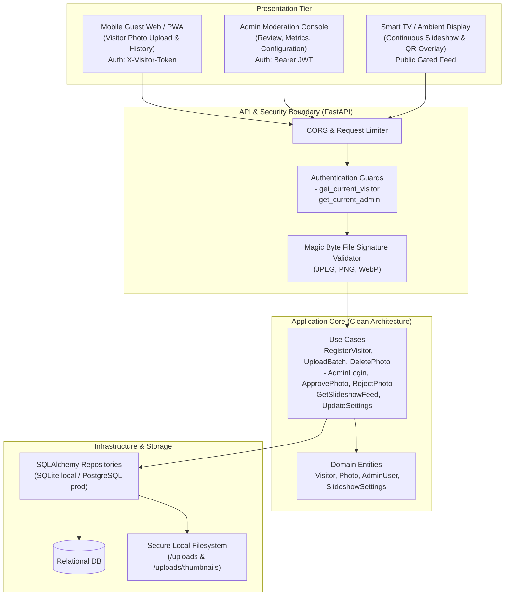
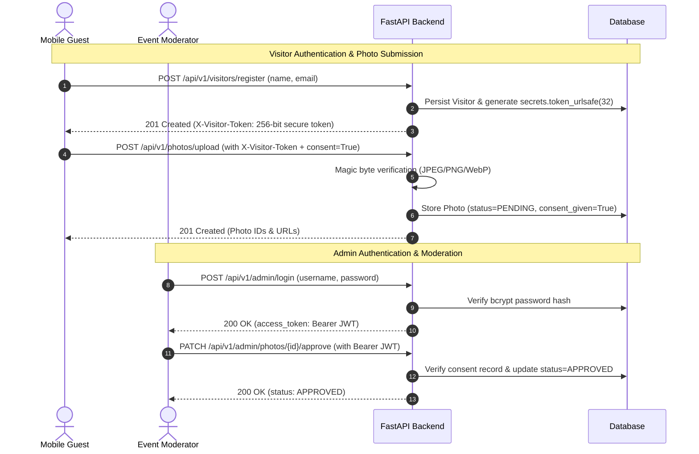
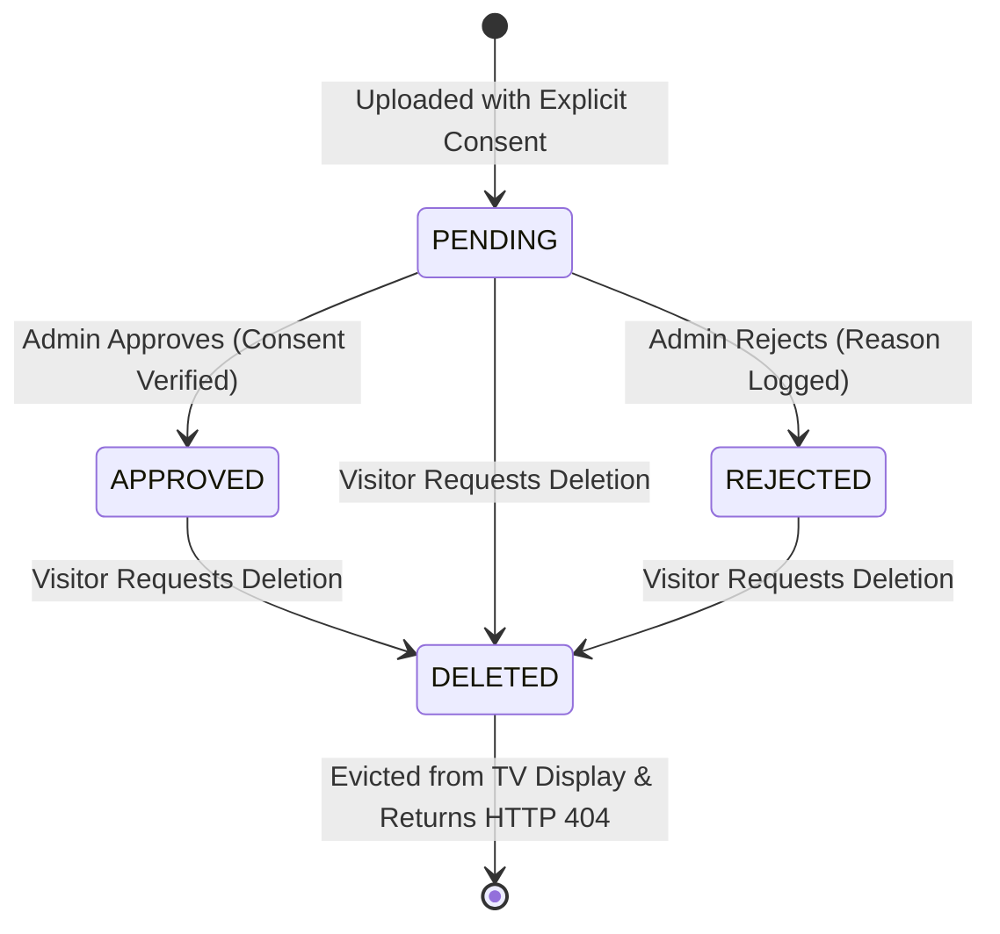
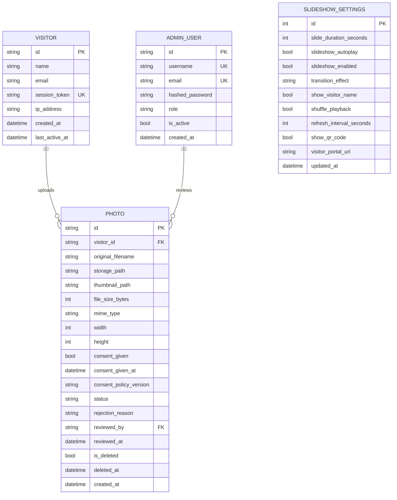

# System Architecture Specification

## 1. Executive Summary & System Overview

The **Visitor Photo Slideshow Application** is an event-driven platform enabling guests at weddings, conferences, and celebrations to upload photos in real-time from mobile devices, while event moderators review incoming media, and ambient Smart TVs display continuous, animated photo loops.



---

## 2. Frontend Layered Architecture (Flutter)

The Flutter application is structured around Clean Presentation and Riverpod state management:

```
frontend/lib/
├── core/
│   ├── constants/       # API endpoints, network timeouts, route names
│   ├── network/         # Dio HTTP client with JWT & visitor token interceptors
│   ├── storage/         # flutter_secure_storage session wrappers
│   └── theme/           # Dark and light event color palettes
├── data/
│   ├── models/          # Immutable JSON serializable DTOs
│   └── repositories/    # API abstraction interfaces (Visitor, Admin, Display)
└── presentation/
    ├── providers/       # StateNotifier providers (Display, Moderation, Auth)
    ├── screens/
    │   ├── visitor/     # Welcome, Registration, Upload, My Photos
    │   ├── admin/       # Login, Dashboard, Moderation, Settings
    │   └── display/     # Smart TV Full-Screen Slideshow & QR Pairing
    └── widgets/         # Shared UI components (StatusBadge, MetricCard)
```

### Communication Flow
- **GoRouter**: Controls navigation with route protection based on active auth states.
- **Dio Client Interceptor**: Inspects endpoint URI patterns. If `/admin/` is targeted, it automatically injects `Authorization: Bearer <jwt>`. For visitor endpoints, it injects `X-Visitor-Token: <token>`.
- **DisplayNotifier**: Implements background polling to query `/api/v1/display/settings` and `/api/v1/display/photos`. Dynamically adapts slide rotation intervals, transitions, and attribution overlays without restarting.

---

## 3. Backend Layered Architecture (FastAPI Clean Architecture)

```
backend/app/
├── core/               # Configuration, security utilities, global exceptions
├── domain/             # Pure entities, value objects, and repository interfaces
├── application/        # Application use cases and Pydantic DTO schemas
├── infrastructure/     # Database models, SQLAlchemy sessions, disk storage, Pillow processor
└── presentation/       # API routers (v1), dependencies, and HTTP handlers
```

### Layer Dependency Inversion
Inner domain entities know nothing of database tables or HTTP frameworks. The presentation layer delegates directly to use cases, which interact with abstract repository interfaces fulfilled by infrastructure classes.

---

## 4. Authentication & Security Boundaries



- **Separation of Concerns**: Visitor sessions cannot authenticate administrative routes. Admin JWTs cannot manipulate visitor upload histories.
- **Public Feed Gate**: `/api/v1/display/photos` and `/api/v1/media/slideshow/{id}` strictly filter photos: `status == APPROVED`, `consent_given == True`, and `is_deleted == False`.

---

## 5. Photo Lifecycle & Immediate Deletion Eviction



When a visitor deletes a photo via `DELETE /api/v1/photos/{id}`:
1. Database flags `is_deleted = True` and stamps `deleted_at`.
2. The photo is immediately filtered out of `/api/v1/display/photos`.
3. The media streaming endpoint `/api/v1/media/slideshow/{id}` immediately serves `HTTP 404 Not Found`.

---

## 6. Smart TV Display Architecture & QR Code Flow

- **Resolution**: Adaptive landscape layout designed for 1080p and 4K displays.
- **Transitions**: Animated cross-fade, slide, and zoom transitions.
- **Controls**: Ambient display mode hides navigation controls. Fullscreen is toggled with the `F` key; slides navigate with TV remote arrow keys and spacebar.
- **QR Code Generation**: Dynamically resolved via `GET /api/v1/display/qr-code` using configured production HTTPS domain (`PUBLIC_PORTAL_URL`). Encodes only the clean visitor portal URL without tokens.

---

## 7. Database Entity Relationship Model


